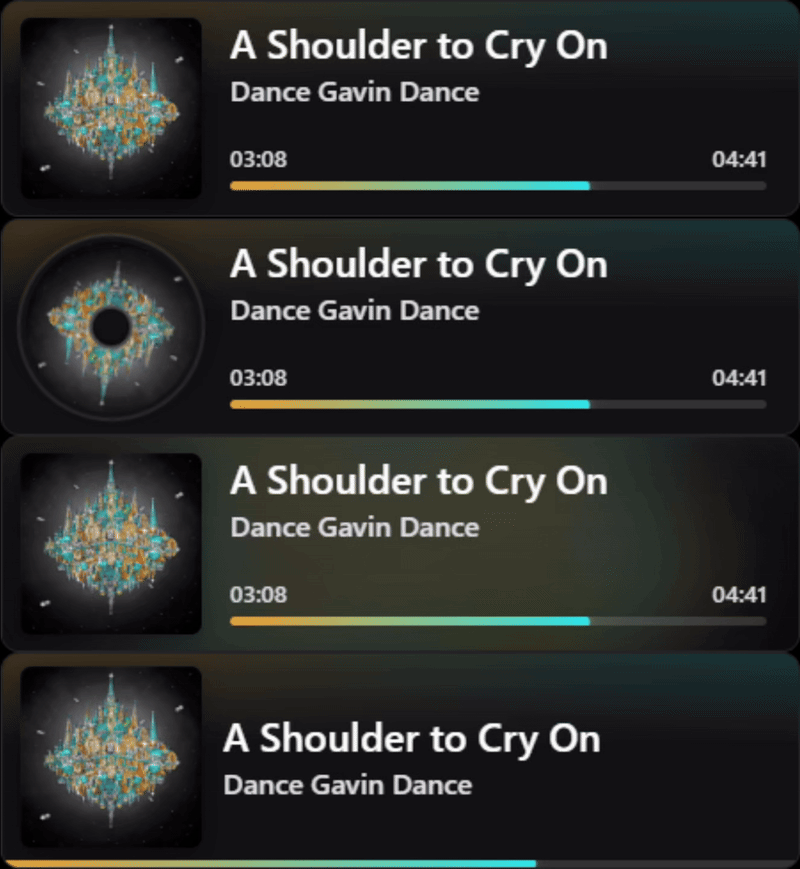
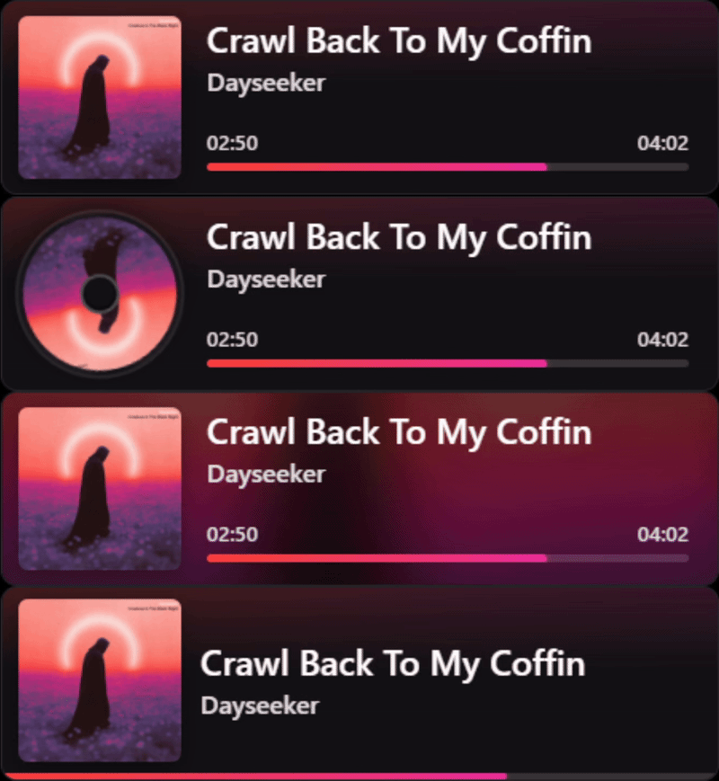
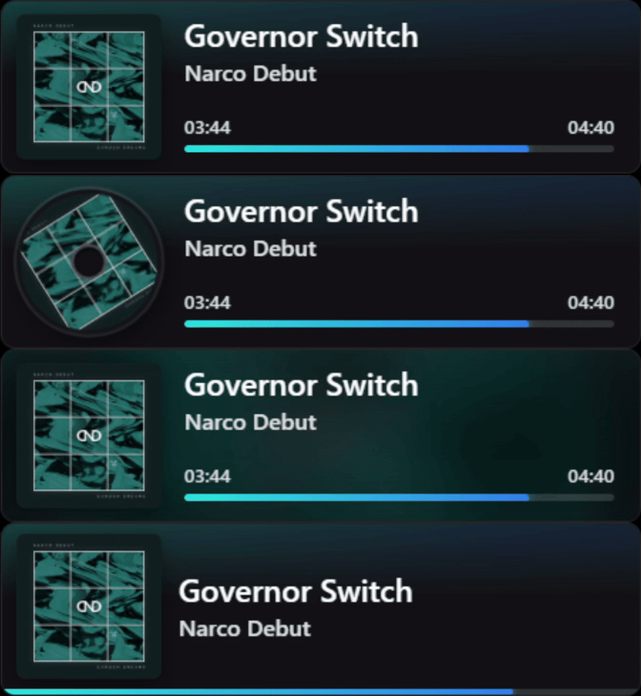
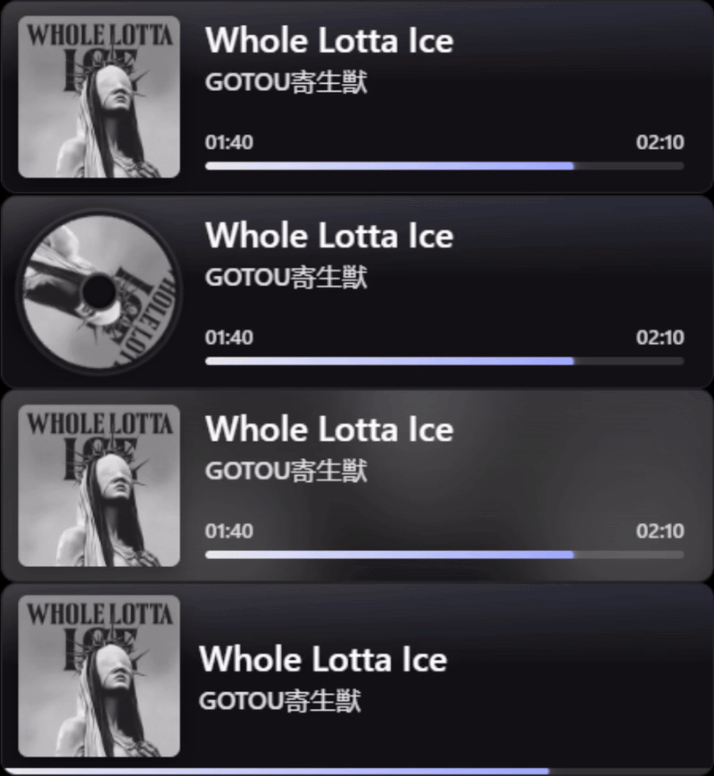

# 🎵 SMTC Now Playing — OBS Browser Source Widget

A lightweight, native **Rust** Windows utility that reads currently playing track metadata via **Windows System Media Transport Controls (SMTC)** and serves a sleek, customizable "Now Playing" overlay as a local **OBS Browser Source**.

<table>
  <tr>
    <td align="center">
      
    </td>
    <td align="center">
      
    </td>
  </tr>
  <tr>
    <td align="center">
      
    </td>
    <td align="center">
      
    </td>
  </tr>
</table>

---

## ✨ Features

* **Native Rust Performance**: Compiles into a standalone **~2 MB `.exe`** with zero external runtime dependencies, instant startup, and **~4 MB RAM** usage.
* **Event-Driven Universal Media Support**: Hooks directly into Windows SMTC session, playback, and metadata change events for instant reaction times across Spotify, Apple Music, YouTube/Twitch in Chrome, Edge, or Firefox, VLC, and more.
* **Per-App Session Filtering**: Allow-list or block-list specific applications (e.g., locking the widget to `Spotify.exe` or ignoring `chrome.exe`) directly from the web settings dashboard so browser videos never hijack your music overlay.
* **Automatic Title & Artist Sanitizer**: Strips noisy video and stream suffixes such as `(Official Music Video)`, `[Lyrics]`, `- YouTube`, and YouTube's `- Topic` channel suffix.
* **Dual-Tone Vibrant Accent Extraction**: Samples album art in HSV color space—filtering out near-black, pure white, and desaturated grey pixels—to extract primary and secondary accent hues (`--accent` and `--accent2`) for a dual-tone neon progress bar and ambient card glow.
* **Decoupled Binary `/art` Caching**: Serves album art as immutable, FNV-1a hash-versioned PNGs (`/art?v=<hash>`) so `/state` JSON polls stay under ~200 bytes.
* **4 Built-In Visual Themes & Toast Mode**: Switch between `default` (Dual-Tone Glow), `vinyl` (Spinning Record), `glass` (Frosted Art Blur), and `compact` (Minimal Bar), or enable **Track Change Toast** mode to pop the widget in temporarily when a new song starts.
* **Plaintext `/text` Endpoint for Chat Bots**: Exposes a customizable plaintext route (`http://127.0.0.1:8765/text`) for Streamer.bot, Nightbot, or Mix It Up `!song` commands.
* **Headless System Tray & Windows Startup Toggle**: Runs silently in the Windows System Tray with quick toggles for **Always Show**, **Launch at Windows Startup**, live settings, and OBS URL copying.
* **Smooth Timeline Interpolation**: Interpolates playback progress at 60 FPS between SMTC updates so the progress bar and `MM:SS` / `H:MM:SS` timestamps advance smoothly.

---

## 🚀 Quick Start (OBS Studio Setup)

1. **Launch the App**: Run `SMTC-Now-Playing.exe`. A pink play icon will appear in your **Windows System Tray**.
2. **Copy the Widget URL**: Right-click the system tray icon and select **Copy OBS URL (`http://127.0.0.1:8765/`)**.
3. **Add to OBS**:
   * In OBS Studio, click **+** under **Sources** and select **Browser**.
   * Paste `http://127.0.0.1:8765/` into the **URL** field.
   * Set the OBS Browser Source **Width** and **Height** large enough to accommodate your widget size (e.g., `600` width × `200` height).
4. **Play Media**: Start playing a track in any media player or browser tab—the widget will smoothly fade in and match the album art's dual-tone palette.

---

## 🎨 Customization

### 1. Live Web Settings Dashboard & Auto-Save
Left-click the system tray icon (or right-click and choose **Widget Size, Themes & Settings...**) to open `http://127.0.0.1:8765/settings` in your browser. All changes update OBS in real time and are atomically saved to `%APPDATA%\SMTC-Now-Playing\config.json`:
* **Visual Theme**: `default`, `vinyl`, `glass`, or `compact`
* **Visibility Mode**: `default` (Show While Playing), `always` (Always Show), or `toast` (Track Change Toast with configurable `3–60 s` duration)
* **Dimensions & Style**: Width (`260–1920 px`), Height (`80–600 px`), Corner Radius (`0–60 px`), and Card Opacity (`0.00–1.00`)
* **App Session Filter**: Choose **All Media Apps**, **Only Allow Listed**, or **Block Listed Apps**, and click any detected active app pill to add it to your filter list
* **Clean Noisy Video Titles**: Automatically removes `(Official Video)`, `[Lyrics]`, `- YouTube`, and `- Topic` suffixes
* **Launch at Windows Startup**: Registers or removes the executable in `HKCU\Software\Microsoft\Windows\CurrentVersion\Run`

### 2. URL Query Parameters (Per-Source Overrides)
If you use multiple Browser Sources across different OBS scenes, you can override the global settings per scene by appending query parameters to the URL:

| Parameter | Default | Description | Example |
| :--- | :--- | :--- | :--- |
| `theme` | `default` | Layout preset: `default`, `vinyl`, `glass`, or `compact` | `?theme=vinyl` |
| `mode` | `default` | Visibility mode: `default`, `always`, or `toast` | `?mode=toast` |
| `toast` | `8` | Toast display duration in seconds (`3` – `60`) when `mode=toast` | `?mode=toast&toast=10` |
| `w` (or `width`) | `510` | Widget width in pixels (`260` – `1920`) | `?w=620` |
| `h` (or `height` / `length`) | `122` | Widget height in pixels (`80` – `600`; album art scales automatically) | `?h=140` |
| `radius` | `10` | Corner roundness of the card in pixels (`0` – `60`) | `?radius=16` |
| `opacity` (or `bg_alpha`) | `1.0` | Opacity of the card background (`0.0` to `1.0`) | `?opacity=0.88` |
| `always_show` | `0` | Set to `1` or `true` to prevent hiding when playback pauses | `?always_show=1` |

**Example Custom URL:**
```text
http://127.0.0.1:8765/?theme=glass&mode=toast&toast=10&w=640&h=135&radius=14&opacity=0.90
```

### 3. Plaintext `/text` Endpoint for Stream Bots
Query `http://127.0.0.1:8765/text` from Streamer.bot, Nightbot, or custom scripts to get a clean plaintext string of the active track. You can customize the default format in `/settings` or override it on the fly via `?format=`:
* **Supported Placeholders**: `{title}`, `{artist}`, `{album}`, `{app}`, `{pos}`, `{dur}`, `{status}`
* **Example**: `http://127.0.0.1:8765/text?format=Now+Playing:+{title}+by+{artist}+[{pos}/{dur}]`

---

## 🛠️ Building from Source

### Requirements
* **OS**: Windows 10 / Windows 11
* **Toolchain**: [Rust (`rustup` / `cargo`)](https://rustup.rs/) with the MSVC build tools

### Project Structure
```text
SMTC-Now-Playing/
├── Cargo.toml        # Crate metadata, dependencies & size-optimized release profile
├── build.rs          # Embeds icon.ico into the compiled Windows executable
├── build.bat         # One-click release build script
├── icon.ico          # Application & executable icon
└── src/
    └── main.rs       # Event-driven SMTC poller, HTTP server, tray icon & HTML/CSS/JS
```

### Build Standalone `.exe`
Double-click `build.bat`, or compile manually from the terminal:
```bash
cargo build --release
```
* `build.bat` automatically closes any running instance, compiles the release binary, copies it to **`dist\SMTC-Now-Playing.exe`**, and refreshes the Windows Explorer icon cache.
* Raw Cargo builds are also available at **`target\release\SMTC-Now-Playing.exe`**.

---

## 📄 License

Licensed under the [MIT License](LICENSE).
