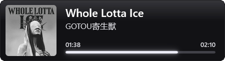
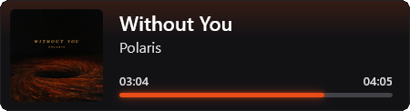
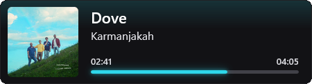

# 🎵 SMTC Now Playing — OBS Browser Source Widget

A lightweight, native **Rust** Windows utility that reads currently playing track metadata via **Windows System Media Transport Controls (SMTC)** and serves a sleek, customizable "Now Playing" overlay as a local **OBS Browser Source**.





---

## ✨ Features

* **Native Rust Performance**: Compiles into a standalone **~2 MB `.exe`** with zero external runtime dependencies, instant startup, and **~4 MB RAM** usage.
* **Universal Windows Media Support**: Automatically detects playback status, track title, artist name, album art, and timeline position from any SMTC-enabled application (Spotify, Apple Music, YouTube/Twitch in Chrome, Edge, or Firefox, VLC, etc.).
* **Dynamic Vibrant Accent Extraction**: Samples the current album art in HSV color space—filtering out near-black, pure white, and desaturated grey pixels—to drive a reactive neon progress bar and subtle top ambient glow.
* **Native OBS Browser Source (`http://127.0.0.1:8765/`)**: Provides clean alpha-channel transparency directly inside OBS Studio without needing Window Capture or color keying.
* **Headless System Tray Operation**: Runs silently in the Windows System Tray with quick actions to open the live settings dashboard, toggle auto-hide, copy the OBS URL, or preview the widget in your browser.
* **Live Web Settings & Interactive Preview (`http://127.0.0.1:8765/settings`)**: Left-click the tray icon (or select **Widget Size & Style...**) to adjust widget width, height, corner radius, and card opacity with a real-time interactive preview. Changes apply immediately in OBS and are atomically saved to `config.json`.
* **Per-Scene URL Overrides**: Customize widget dimensions and visibility per OBS scene using standard URL query parameters.
* **Smooth Timeline Interpolation**: Interpolates playback progress at 60 FPS between background SMTC polls so the progress bar and `MM:SS` / `H:MM:SS` timestamps advance smoothly.

---

## 🚀 Quick Start (OBS Studio Setup)

1. **Launch the App**: Run `SMTC-Now-Playing.exe`. A pink play icon will appear in your **Windows System Tray**.
2. **Copy the Widget URL**: Right-click the system tray icon and select **Copy OBS URL (`http://127.0.0.1:8765/`)**.
3. **Add to OBS**:
   * In OBS Studio, click **+** under **Sources** and select **Browser**.
   * Paste `http://127.0.0.1:8765/` into the **URL** field.
   * Set the OBS Browser Source **Width** and **Height** large enough to accommodate your widget size (e.g., `600` width × `200` height).
4. **Play Media**: Start playing a track in any media player or browser tab—the widget will smoothly fade in and match the album art's accent color.

---

## 🎨 Customization

### 1. Live Web Settings Dashboard & Auto-Save
Left-click the system tray icon (or right-click and choose **Widget Size & Style...**) to open `http://127.0.0.1:8765/settings` in your browser. All changes update OBS in real time and are automatically saved to `%APPDATA%\SMTC-Now-Playing\config.json`:
* **Width**: `260 px` – `1920 px` (Default: `510 px`)
* **Height (Length)**: `80 px` – `600 px` (Default: `122 px`)
* **Corner Radius**: `0 px` – `60 px` (Default: `10 px`)
* **Card Opacity**: `0.00` – `1.00` (Default: `1.00`)
* **Always Show (Disable Auto-Hide)**: Toggleable in both the web settings page and the system tray right-click menu to keep the widget visible when playback is paused or stopped.

### 2. URL Query Parameters (Per-Source Overrides)
If you use multiple Browser Sources across different OBS scenes, you can override the global settings by appending query parameters to the URL:

| Parameter | Default | Description | Example |
| :--- | :--- | :--- | :--- |
| `w` (or `width`) | `510` | Widget width in pixels (`260` – `1920`) | `?w=620` |
| `h` (or `height` / `length`) | `122` | Widget height in pixels (`80` – `600`; album art scales automatically) | `?h=140` |
| `radius` | `10` | Corner roundness of the card in pixels (`0` – `60`) | `?radius=16` |
| `opacity` (or `bg_alpha`) | `1.0` | Opacity of the dark `#121215` card background (`0.0` to `1.0`) | `?opacity=0.88` |
| `always_show` | `0` | Set to `1` or `true` to prevent hiding when playback pauses | `?always_show=1` |

**Example Custom URL:**
```text
http://127.0.0.1:8765/?w=640&h=135&radius=14&opacity=0.90&always_show=1
```

---

## 🛠️ Building from Source

### Requirements
* **OS**: Windows 10 / Windows 11
* **Toolchain**: [Rust (`rustup` / `cargo`)](https://rustup.rs/) with the MSVC build tools

### Project Structure
```text
SMTC-Now-Playing/
├── Cargo.toml        # Crate metadata, dependencies & size-optimized release profile
├── build.rs          # Embeds icon.ico into the compiled Windows executable
├── build.bat         # One-click release build script
├── icon.ico          # Application & executable icon
└── src/
    └── main.rs       # SMTC poller, HTTP server, tray icon & embedded HTML/CSS/JS
```

### Build Standalone `.exe`
Double-click `build.bat`, or compile manually from the terminal:
```bash
cargo build --release
```
* `build.bat` automatically compiles the release binary, copies it to **`dist\SMTC-Now-Playing.exe`**, and refreshes the Windows Explorer icon cache.
* Raw Cargo builds are also available at **`target\release\SMTC-Now-Playing.exe`**.

---

## 📄 License

Licensed under the [MIT License](LICENSE).
