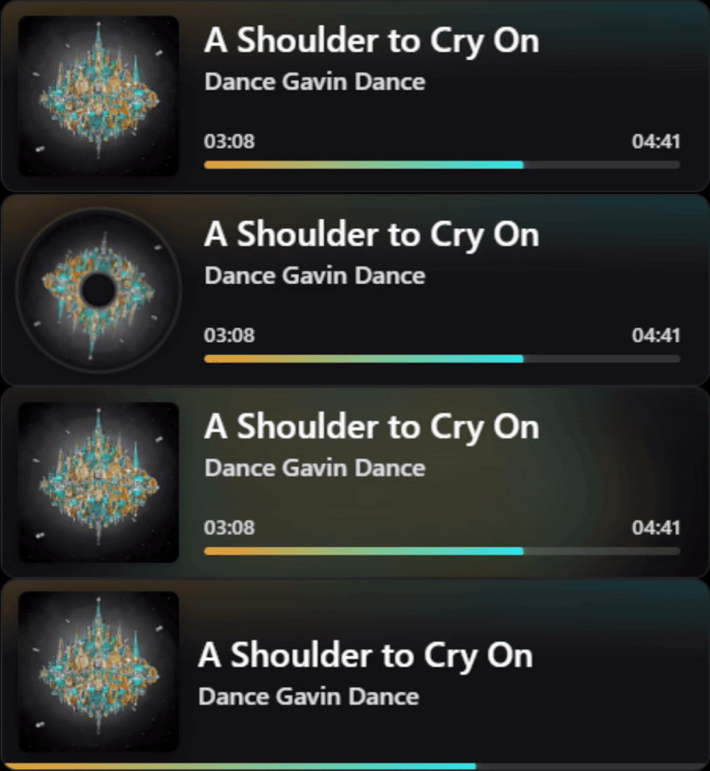

# 🎵 SMTC Now Playing — OBS Browser Source Widget

A lightweight, native **Rust** Windows utility that reads currently playing track metadata via **Windows System Media Transport Controls (SMTC)** and serves a sleek, customizable "Now Playing" overlay as a local **OBS Browser Source**.

<table>
  <tr>
    <td align="center">
      
    </td>
  </tr>
</table>

---

## ✨ Features

* **Ultra-Lightweight Native Rust**: Compiles into a standalone `.exe` with minimal dependencies (no async runtime, no image-processing crate, and no external runtime dependencies), instant startup, low RAM footprint, and zero idle wake-ups via an event-driven Win32 tray loop.
* **Event-Driven Universal Media Support**: Hooks directly into Windows SMTC session, playback, timeline, and metadata change events for instant reaction times across Spotify, Apple Music, YouTube in Chrome, Edge, or Firefox, and more—including multi-instance apps and live-stream timeline offsets.
* **Real-Time Server-Sent Events (`/events`)**: Uses a lightweight, zero-dependency synchronous HTTP/1.1 + SSE server to push live track and settings updates immediately to OBS and the settings dashboard without polling.
* **Per-App Session Filtering**: Allow-list or block-list specific applications (e.g., locking the widget to `Spotify.exe` or ignoring `chrome.exe`) directly from the web settings dashboard so browser videos never hijack your music overlay.
* **Automatic Title & Artist Sanitizer**: Strips noisy video and stream suffixes such as `(Official Music Video)`, `[Lyrics]`, `- YouTube`, and YouTube's `- Topic` channel suffix.
* **Browser-Side Dual-Tone Accent Extraction**: Serves raw cover art straight from SMTC without server-side decoding, then samples it in the browser via an offscreen `<canvas>` in HSV color space—filtering out near-black and desaturated pixels to extract primary and secondary accent hues (`--accent` and `--accent2`) for the progress bar and ambient card glow.
* **Decoupled Binary `/art` Caching**: Sniffs image MIME types (`PNG`, `JPEG`, `WebP`, `GIF`, `BMP`) and serves immutable, 32-bit FNV-1a hash-versioned artwork (`/art?v=<hash>`) so live state payloads stay tiny.
* **4 Built-In Visual Themes & Toast Mode**: Switch between `default` (Dual-Tone Glow), `vinyl` (Spinning Record), `glass` (Frosted Art Blur), and `compact` (Minimal Bar), or enable **Track Change Toast** mode to pop the widget in temporarily when a new song starts.
* **Custom Fonts & Proportional Sizing**: Choose from curated font presets (`Segoe UI`, `Inter`, `Poppins`, `Montserrat`, `Roboto`, `Outfit`, `Space Grotesk`, `Oswald`, `JetBrains Mono`, `Consolas`, `Georgia`) or enter any installed Windows font or Google Font, with adjustable base font sizing (`12–48 px`) and automatic marquee scroll recalculation.
* **Plaintext `/text` Endpoint for Chat Bots**: Exposes a customizable plaintext route (`http://127.0.0.1:8765/text`) for Streamer.bot, Nightbot, or Mix It Up `!song` commands.
* **Headless System Tray & Windows Startup Toggle**: Runs silently in the Windows System Tray with native Win32 clipboard URL copying, instant browser preview (`/?mode=always`), and quick toggles for **Always Show** and **Launch at Windows Startup**.
* **Smooth Timeline Interpolation**: Interpolates playback progress at your display's refresh rate (`requestAnimationFrame`) between SMTC updates so the progress bar and `MM:SS` / `H:MM:SS` timestamps advance smoothly.

---

## 🚀 Quick Start (OBS Studio Setup)

1. **Launch the App**: Run `SMTC-Now-Playing.exe`. A pink play icon will appear in your **Windows System Tray**.
2. **Copy the Widget URL**: Right-click the system tray icon and select **Copy OBS URL (`http://127.0.0.1:8765/`)**.
3. **Add to OBS**:
   * In OBS Studio, click **+** under **Sources** and select **Browser**.
   * Paste `http://127.0.0.1:8765/` into the **URL** field.
   * Set the OBS Browser Source **Width** and **Height** large enough to accommodate your widget size (e.g., `600` width × `200` height).
4. **Play Media**: Start playing a track in any media player or browser tab—the widget will smoothly fade in and match the album art's dual-tone palette.

---

## 🎨 Customization

### 1. Live Web Settings Dashboard & Auto-Save
Left-click the system tray icon (or right-click and choose **Widget Size, Themes & Settings...**) to open `http://127.0.0.1:8765/settings` in your browser. All changes update OBS in real time and are atomically saved to `%APPDATA%\SMTC-Now-Playing\config.json` (if a config file ever becomes malformed, it is backed up to `config.json.bak` rather than silently wiped):
* **Visual Theme**: `default`, `vinyl`, `glass`, or `compact`
* **Font Family & Size**: Choose from built-in presets or select **Custom Font...** to enter any installed Windows font or Google Font family name, and adjust **Font Size** (`12–48 px`, default `22 px`) with artist and timestamp text scaling proportionally
* **Visibility Mode**: `default` (Show While Playing), `always` (Always Show / Show While Paused), or `toast` (Auto-Hide on Track Change with configurable `3–60 s` duration)
* **Dimensions & Style**: Width (`260–1920 px`), Height (`80–600 px`), Corner Radius (`0–60 px`), and Card Opacity (`0.00–1.00`)
* **App Session Filter**: Choose **Track All Media Apps**, **Included Apps Only**, or **Excluded Apps**, and click any detected active app pill in the active sources drawer to add or remove it
* **Clean Noisy Video Titles**: Automatically removes `(Official Video)`, `[Lyrics]`, `- YouTube`, and `- Topic` suffixes
* **Import & Reset Presets**: Use **Load Settings** to paste and import an existing widget URL, or **Load Default Settings** to reset back to defaults
* **Launch at Windows Startup**: Registers or removes the executable in `HKCU\Software\Microsoft\Windows\CurrentVersion\Run`

### 2. URL Query Parameters (Per-Source Overrides)
If you use multiple Browser Sources across different OBS scenes, you can override the global settings per scene by appending query parameters to the URL:

| Parameter | Default | Description | Example |
| :--- | :--- | :--- | :--- |
| `theme` | `default` | Layout preset: `default`, `vinyl`, `glass`, or `compact` | `?theme=vinyl` |
| `font` (or `font_family`) | `Segoe UI` | Font family name (any installed Windows font or Google Font) | `?font=Inter` |
| `font_size` (or `fontsize` / `size`) | `22` | Base track title font size in pixels (`12` – `48`); artist & timestamps scale proportionally | `?font_size=24` |
| `mode` | `default` | Visibility mode: `default`, `always`, or `toast` | `?mode=toast` |
| `toast` | `8` | Toast display duration in seconds (`3` – `60`) when `mode=toast` | `?mode=toast&toast=10` |
| `w` (or `width`) | `510` | Widget width in pixels (`260` – `1920`) | `?w=620` |
| `h` (or `height` / `length`) | `122` | Widget height in pixels (`80` – `600`; album art scales automatically) | `?h=140` |
| `radius` | `10` | Corner roundness of the card in pixels (`0` – `60`) | `?radius=16` |
| `opacity` (or `bg_alpha`) | `1.0` | Opacity of the card background (`0.0` to `1.0`) | `?opacity=0.88` |
| `always_show` | `0` | Set to `1` or `true` to prevent hiding when playback pauses | `?always_show=1` |

**Example Custom URL:**
~~~text
http://127.0.0.1:8765/?theme=glass&font=Inter&font_size=24&mode=toast&toast=10&w=640&h=135&radius=14&opacity=0.90
~~~

### 3. Plaintext `/text` Endpoint for Stream Bots
Query `http://127.0.0.1:8765/text` from Streamer.bot, Nightbot, or custom scripts to get a clean plaintext string of the active track. You can customize the default format in `/settings` or override it on the fly via `?format=` (up to 512 bytes):
* **Supported Placeholders**: `{title}`, `{artist}`, `{album}`, `{app}`, `{pos}`, `{dur}`, `{status}`
* **Example**: `http://127.0.0.1:8765/text?format=Now+Playing:+{title}+by+{artist}+[{pos}/{dur}]`

---

## 🔌 Local API & Architecture

The server binds exclusively to loopback (`127.0.0.1:8765`) so only local applications (like OBS, browsers, and chat bot scripts) can connect.

### Endpoints

| Method & Path | Description |
| :--- | :--- |
| `GET /` (or `/index.html`) | Serves the embedded OBS Browser Source widget (`widget.html`) |
| `GET /settings` | Serves the live settings dashboard and interactive preview (`settings.html`) |
| `GET /events` | Server-Sent Events (`text/event-stream`) feed pushing live JSON state updates (`Host`/`Origin` validated) |
| `GET /state` | One-shot JSON snapshot of current track metadata, interpolated position, config, and startup status |
| `GET /art` | Raw album cover bytes with detected image MIME type (`immutable` caching with `?v=<hash>`, `no-store` without) |
| `GET /text` | Plaintext formatted track status with optional `?format=` template override |
| `POST /config` | Validates, applies, and debounces saving global settings (`application/json` + local `Host`/`Origin` check, 8 KB limit) |
| `POST /startup` | Enables or disables launching at Windows sign-in (`application/json` + local `Host`/`Origin` check, 1 KB limit) |

### Architecture Overview
* **UI / Tray Thread (`main.rs`)**: Owns the system tray icon and blocks on `GetMessageW` with an on-demand Win32 timer for debounced config writes—consuming 0% CPU while idle.
* **SMTC Listener Thread (`smtc.rs`)**: Subscribes to WinRT `GlobalSystemMediaTransportControlsSessionManager` and session events, sleeping via `thread::park()` until Windows reports a change.
* **Sync HTTP + SSE Server (`server.rs`)**: Built directly on `std::net::TcpListener` with a `Mutex`/`Condvar` `StateHub` for zero-copy SSE fan-out—eliminating async runtime bloat while serving embedded HTML assets directly from the binary.

---

## 🛠️ Building from Source

### Requirements
* **OS**: Windows 10 / Windows 11
* **Toolchain**: [Rust 1.85+ (`rustup` / `cargo`)](https://rustup.rs/) (Edition 2024) with the MSVC build tools

### Project Structure
~~~text
smtc-now-playing/
├── Cargo.toml
├── build.rs
└── src/
    ├── main.rs            # Entry point, procedural tray icon & event-driven Win32 loop
    ├── config.rs          # Config, MediaState, SharedApp & atomic JSON persistence
    ├── win32.rs           # Registry Run key, clipboard, COM guard & Win32 FFI helpers
    ├── metadata.rs        # Title/artist sanitizer & /text template formatter
    ├── smtc.rs            # WinRT MediaManager hooks, poller thread & raw art reader
    ├── server.rs          # Sync HTTP/1.1 + SSE (/events) server & route handlers
    └── assets/
        ├── widget.html    # Browser source UI & canvas-based accent color extraction
        └── settings.html  # Settings dashboard & live preview UI
~~~

### Build Standalone `.exe`
Double-click `build.bat`, or compile manually from the terminal:
~~~bash
cargo build --release
~~~
* `build.bat` automatically closes any running instance, compiles the release binary, copies it to **`dist\SMTC-Now-Playing.exe`**, and refreshes the Windows Explorer icon cache.
* Raw Cargo builds are also available at **`target\release\SMTC-Now-Playing.exe`**.

---

## 🤖 Disclaimer

This project was made with the help of **Gemini**.

---

## 📄 License

Licensed under the [MIT License](LICENSE).